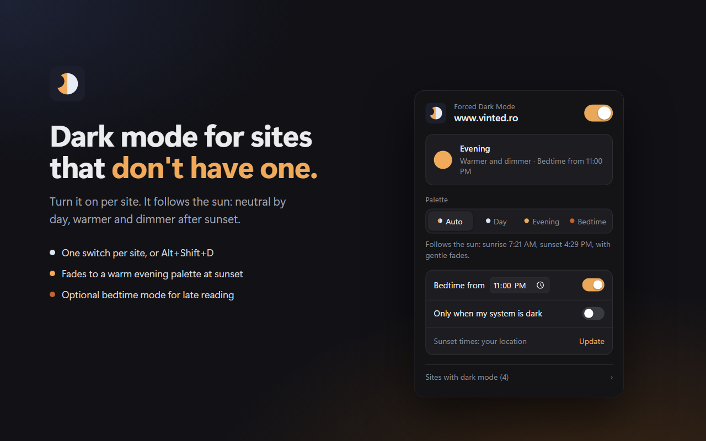

# Forced Dark Mode

A Chrome extension that gives a dark mode to sites that don't have one. You turn it on per site, and it follows the sun: a neutral dark grey by day, warmer and dimmer after sunset, and an optional bedtime palette.



## Features

- Per-site switch in the popup, **Alt+Shift+D**, or the right-click menu
- Photos, videos and background images keep their normal colours
- Sites that are already dark are detected (the popup also checks what is on screen) and skipped; you can force it anyway
- **Auto** palette: Day → Evening fades in over 40 min after sunset and back after sunrise
- Optional **Bedtime** palette from a time you choose
- "Only when my system is dark" option
- A coloured dot on the toolbar icon shows the current palette
- Asks for access one site at a time, only when you turn it on there
- No servers, no tracking. See [PRIVACY.md](PRIVACY.md)

## Install from source

1. Open `chrome://extensions` and turn on **Developer mode**.
2. Click **Load unpacked** and pick this folder.

## Build a store zip

```powershell
./build.ps1
```

This creates `dist/forced-dark-mode-<version>.zip` with just the extension files.

## How it works

The page is inverted with a CSS filter and the hue rotated 180°, so colours keep their identity; media elements are flipped back. The palette (invert, sepia, brightness, contrast) is blended over time in [sun.js](sun.js), using a NOAA-style sunrise equation.
